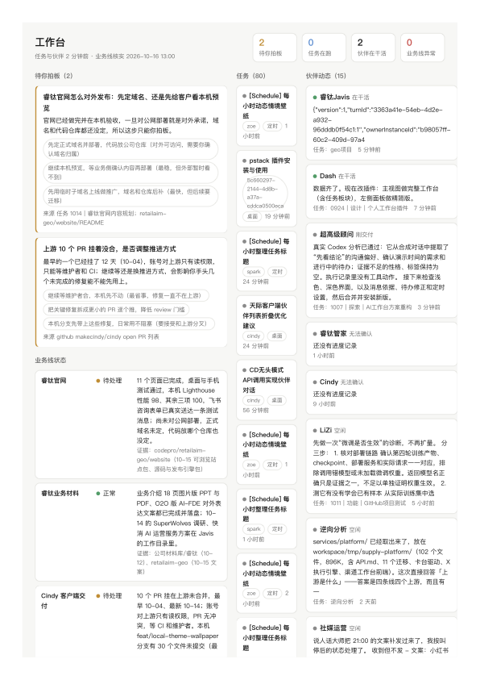

# Cindy 个人工作台插件（cindy-personal-workbench）

一个给 [Cindy](https://github.com/makecindy/cindy) 桌面端用的插件（Ghost）：把「等你拍板的事」和「伙伴 / 任务的实时状态」放进一个整页工作台，不用再去翻任务列表。



## 它解决什么问题

你在 Cindy 里同时跑着很多任务和多个伙伴（Bot）时，常见的问题是：不知道谁在干活、哪条线卡住了、哪些事在等你决定。这个插件把这些收敛成三件事：

1. **待你拍板**：只放真正需要本人决定的事（涉及费用、对外承诺、方向取舍、风险），由巡检任务写入，能直接点「已处理」移出。
2. **任务**：正在跑 / 排队中 / 一天内 / 停着的任务一览，带项目、来源（定时 / 桌面 / 伙伴）、模型、消息数和最近更新时间。
3. **伙伴动态与业务线状态**：每个伙伴最近在做什么、什么状态；业务线只有五种状态：正常 / 异常 / 待处理 / 无法确认 / 未接入，未接入不会伪装成正常。

## 界面形态

- **一级主视图（整页）**：侧边栏「工作台」进入，三栏布局（待拍板 + 业务线 / 任务 / 伙伴），窄屏自动收成单栏。
- **左侧停靠面板（精简版）**：只放待拍板和在干活 / 刚交付的伙伴，适合经常瞟一眼。

## 安装

1. 在 Cindy 桌面端打开侧边栏「插件」→ 导入本地插件包，选择本仓库 Release 里的 `.cindy` 文件。
2. 首次安装会列出权限清单，确认后启用。
3. 打开侧边栏「工作台」；左侧面板会同时出现在聊天窗左侧。

从源码打包：

```bash
# 在 Cindy 会话里，用 ghost_forge_pack(dir = 本仓库路径) 生成 .cindy
```

## 工作原理

```
Cindy 桌面端
├── Ghost 沙箱页面（main.js）      电子脑，管状态、发通知、和面板通信
├── main-view.html / workbench.html 整页主视图 / 左侧精简面板
└── node/worker.cjs                常驻 Node 进程，只读本机会话库
```

- Node 进程每 20 秒以**只读**方式打开本机 Cindy 的 SQLite 会话库（`~/Library/Application Support/Cindy/cindy-*.db`），读取 `sessions` 与最近一条 `messages`；
- 从 `sessions.active_turn_started_at` 判断某个伙伴是否正在干活，从 `messages` 取最近一条回复做进度摘要；
- 结果写入插件自己的 KV（`/kv`），页面通过 `BroadcastChannel` 实时收到更新；
- 插件同时订阅 Cindy 的 `turn` / `session` 事件，本会话的轮次变化会即时反映到界面；
- 另有一条可选的巡检任务（cron）把业务线状态和「待你拍板」写进工作台，插件只在新出现异常或新待决策时弹提示 + 亮绿点。

## 权限与隐私

装这个插件会看到这些权限，请按需评估：

| 能力 | 用途 |
|---|---|
| 一级主视图 / 左侧面板 | 提供界面 |
| 随包 Node 进程（常驻） | 只读扫描本机会话库，用于伙伴与任务状态 |
| 系统提示 / 未读角标 | 异常和待决策时提醒你 |
| 例行任务事件源 | 用于把伙伴活动交给例行任务（可选） |
| 对话事件订阅 | 感知本会话轮次变化 |

说明：

- 扫描是**只读**的，不写数据库、不上传任何数据，不联网；
- 只有本机数据。**远端设备上的伙伴不会被覆盖**（见「已知限制」）；
- 会话正文只取最近一条并截断展示，不落盘到别处。

## 目录结构

```
ghost.json          插件身份卡（schemaVersion 3）
main.js             电子脑：状态、通知、面板通信、工具实现
main-view.html      一级主视图（整页工作台）
workbench.html      左侧停靠面板（精简版）
workbench.css       两个界面共用的样式
workbench.js        两个界面共用的渲染逻辑
node/worker.cjs     常驻 Node 进程，只读扫描本机会话库
assets/icon.png     插件图标
```

暴露给 Agent 的工具：

- `workbench_publish`：整体写入业务线状态与待决策事项
- `workbench_publish_agents`：按伙伴合并写入进度
- `workbench_get_state`：读取当前状态
- `workbench_mark_done`：把某条待决策标记为已处理

## 已知限制

- 只覆盖本机；跨设备需要 Cindy 官方开放伙伴活动数据（已向官方提 feature request）。
- 直接读本机 SQLite 属于未公开契约，Cindy 数据库结构变化可能导致扫描失败（失败时会保留上一次数据，不会写坏）。
- 任务列表默认只看最近 90 条会话。

## Roadmap

- [ ] 接入官方伙伴活动 API 后，去掉对本地 SQLite 的直接依赖
- [ ] 跨设备伙伴状态
- [ ] 业务线自定义（目前内置「睿钛公司业务」「Cindy 技术交付」两条示例线）
- [ ] 任务分组视图（按项目聚合）

## English

A personal workbench plugin (Ghost) for the Cindy desktop app. It shows three things in one page: decisions waiting for you, a live task board, and teammate/agent activity. A resident Node worker reads the local Cindy SQLite session store read-only every 20s to derive "who is working on what"; the UI is a full-page main view plus a compact docked panel. No network access, no writes to other data. MIT licensed.

Topics: `cindy` `cindy-plugin` `ghost` `workbench` `dashboard` `agent-observability` `local-first` `sqlite`

## License

MIT
